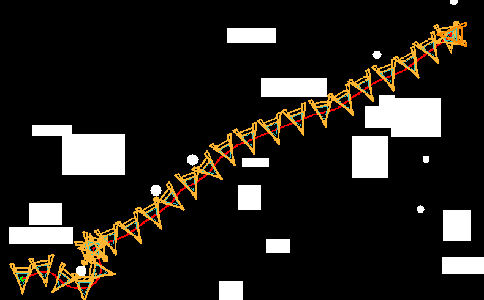
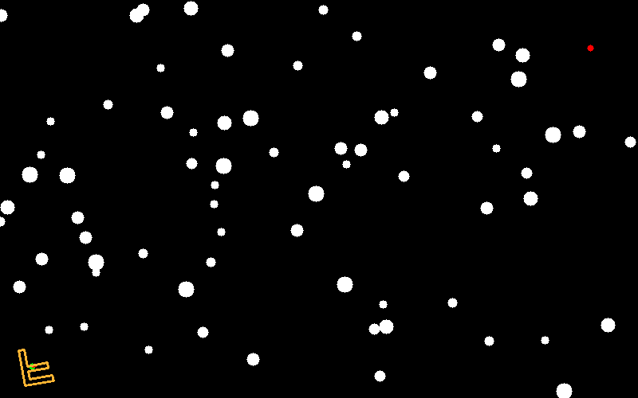
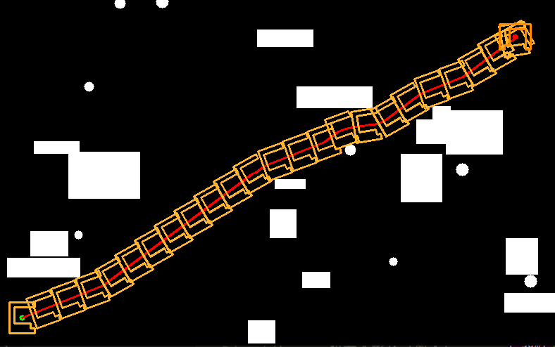
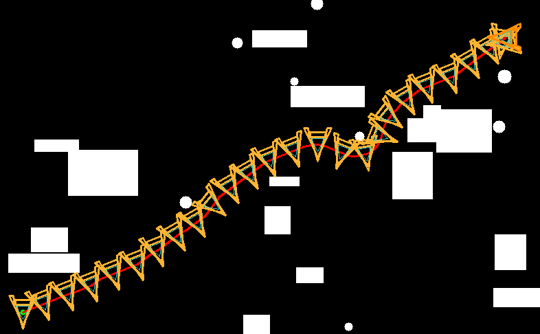

# AnyShapeAStar

**任意形状（含内孔）前端 A* 路径规划** —— 仅依赖 **OpenCV + Eigen**，可在二维栅格地图上对 **凹多边形/带洞的机器人外形**进行 SE(2) 搜索（位置 + 朝向离散）。提供简洁的 CMake 工程、OpenCV 可视化、以及可选 **GIF 动画**导出（ffmpeg 或 ImageMagick）。
<p align="center">
  
</p>


<p align="center">
  
</p>

---

## ✨ 特性

* **任意形状**：用外轮廓 + 多个“孔”描述机器人，旋转后与地图 ROI 做掩膜重叠检测，简单直观。
* **离散 SE(2) A***：状态 [(x, y, θ_bin)]，动作包括直行、转向+前进、原地小转向。
* **OpenCV 可视化**：显示栅格地图、最终路径；可沿路径绘制机器人轮廓。
* **随机地图生成**：矩形、圆形、以及大量“零星小点”障碍，方便压力测试。
* **GIF 导出（可选）**：回放路径生成动画，自动调用 `ffmpeg` 或 `convert` 合成。

---

## 📁 目录结构

```
.
├── CMakeLists.txt
├── include
│   ├── astar.hpp      # A* 主体（Node、AnyShapeAStar）
│   ├── gridmap.hpp    # 地图与随机障碍生成
│   └── shape.hpp      # PolygonalShape（外轮廓+内孔，碰撞检测；含 MakeA/MakeF）
└── src
    └── main.cpp       # 参数、运行入口；可导出 GIF
```

---

## 🚀 快速上手

### 1) 依赖安装（Ubuntu）

```bash
sudo apt update
sudo apt install -y build-essential cmake libeigen3-dev libopencv-dev
# 若需自动合成 GIF（二选一或都装）
sudo apt install -y ffmpeg
# 或
sudo apt install -y imagemagick
```

### 2) 构建 & 运行

```bash
mkdir -p build && cd build
cmake ..
make -j
./anyshape_astar_demo
```

程序默认：

* 地图：`800×500` @ `0.05 m/px`
* 形状：大写 **A**（带三角内孔）
* 只显示**最终路径**，并沿路径以一定步长绘制多个姿态的机器人轮廓
* 若启用 GIF 导出，会在 `build/anim_frames/` 下生成帧，并尝试合成 `path_animation.gif`

---

## 🧪 运行效果（pictures）

<p align="center">
  
</p>

<p align="center">
  
</p>


```
pictures/
├── final_path.png        # 最终路径示意
├── a_shape.png           # A 形机器人轮廓示意
├── f_shape.png           # F 形机器人轮廓示意（修复版，外观清晰）
└── anim.gif              # 路径回放动画（可用 build/path_animation.gif 拷贝过来）
```


---

## ⚙️ 参数与常用修改

在 `src/main.cpp` 顶部：

```cpp
const ShapeChoice shape_choice = ShapeChoice::AShape; // 切换 A / F
const int W = 800, H = 500;        // 地图尺寸（像素）
const double mpp = 0.05;           // 地图分辨率（米/像素）
const int theta_bins = 36;         // 角度离散数（10° 粒度）
const double step_pix = 5.0;       // 前进步长（像素）
```

**选择形状：**

```cpp
if (shape_choice == ShapeChoice::FShape) {
  // 修复后的标准“大 F”
  agent = PolygonalShape::MakeF(/*w=*/1.80, /*h=*/2.20, /*t=*/0.34);
} else {
  // 大 A（带三角孔）
  agent = PolygonalShape::MakeA(/*w=*/2.00, /*h=*/2.40, /*t=*/0.32, /*with_hole=*/true);
}
```

**调形状大小：**

* 直接改 `MakeA/MakeF` 的 `w, h, t`（米，建议从 2~3m 范围试起）；
* 或在 `shape.hpp` 给 `PolygonalShape` 加一个 `scaled(double s)` 方法后使用：

  ```cpp
  agent = PolygonalShape::MakeA(2.00, 2.40, 0.32, true).scaled(1.25); // 放大 25%
  ```


## 🧠 算法简述

* **搜索空间**：离散 SE(2)（位置像素 + 角度索引）
* **动作**：直行、左/右转 + 前进、原地小转（可扩展）
* **代价**：前进距离 + 角度轻惩罚；原地转向稍贵
* **启发**：欧氏距离 + 角度差小惩罚（可替换为 ESDF 等更强启发）
* **碰撞**：将多边形（含孔）按角度旋转，映射到像素，在 ROI 上 `fillPoly` 成掩膜，对地图 ROI 做 `bitwise_and`，重叠即碰撞

更详细的讲解参见本仓库中的文档《任意形状前端 A*：原理与代码实现说明》。

---
